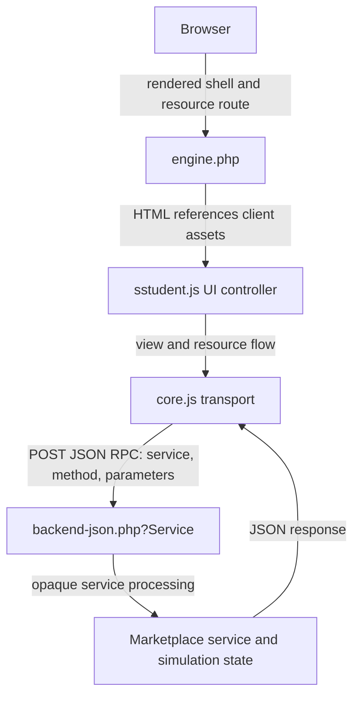

# Observable architecture

## Evidence map

| Claim | Status | Evidence |
|---|---|---|
| Rendered pages load browser JavaScript assets including `core.js` and `sstudent.js` | `VERIFIED_RENDERED_HTML` | Six local HTML exports; asset names only are published |
| The UI controller routes resources and loads view content | `VERIFIED_CLIENT_CODE` | Static call graph includes `menuClickCallback`, `changeResource`, `play`, `setContent`, and `doLoad` |
| The client transport sends JSON requests through `core.js` functions resembling `fetch`, `ajax`, and `send` | `VERIFIED_CLIENT_CODE` | Static symbols and call edges, with one captured request initiator stack |
| Service requests use `POST /mpl/web7/backend-json.php?<Service>` and JSON envelopes with a `method` and `parameters` | `VERIFIED_NETWORK_TRACE` | Sanitized HAR schemas and endpoint aliases |
| `engine.php` is the application shell/resource router | `INFERRED_FROM_MULTIPLE_OBSERVATIONS` | HTML pages, client route strings, and resource-loading call flow; server PHP source was not present |
| `backend-json.php` dispatches requests to service handlers | `INFERRED_FROM_MULTIPLE_OBSERVATIONS` | Service query names and repeated JSON request/response patterns; server implementation was not present |
| Server-side simulation formulas and persistent-state implementation | `UNKNOWN` | Not delivered in browser evidence |

The diagram distinguishes what the browser shows from what is inferred about the server. Neither PHP implementation was acquired, and no attempt was made to obtain it.

## Analysis workflow reference

Since `rea/full-reconstruction`, the analysis runs on [REA](https://github.com/morluto/rea) 6.8.0 (Node 24.22.2). Transport and dispatch claims above are now located in code: `core.js:5:7918` (JSON envelope), `core.js:5:8575` (`backend-json.php?` + service), and `sstudent.js:1:182053`/`:1:188141` (service = screen class name). The round-one Python parsers are in `legacy/`. See `docs/rea-pivot.md` and `docs/reconstruction-report.md`.
