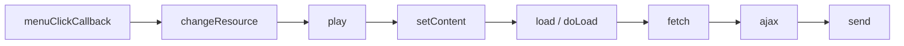

# Client architecture

## Observed assets and entry flow

The six rendered HTML pages refer to `cdn-check.js`, `core.js`, `sstudent-en-us.js`, and `sstudent.js`. Two unique JavaScript bundle contents were present locally and analyzed; repeated copies were deduplicated. The client symbol index includes 9,435 named function signatures. It contains 84 class-like declarations. Those counts describe this capture, not every version or route of the application.

The static call graph supports this client-side sequence:

Relevant observed symbols include `menuClickCallback`, `changeResource`, `play`, `setContent`, `load`, `doLoad`, `fetch`, `ajax`, and `send`. The controller/transport edge locations are in `data/client_call_graph.json`; function signatures and offsets are in `data/client_symbols.json`. Exact offsets use the evidence alias `client_asset_002.js`, never the original local file path.

The calculation-name heuristic flags 118 function occurrences across 38 unique names for review. Examples include `getDemandMultiplier`, `getProductivityTable`, `getRFPIndex`, `dailyCapacity`, and many `writeCalculate` handlers. These names alone do not establish a formula. They are recorded as `UNKNOWN` with no copied expression until their body, dependencies, and server/client data flow are sufficiently understood.

## Route and state handling

Client-delivered strings include routes for `engine.php`, `gengine.php`, and `backend-json.php`. The HTML and JavaScript show resource, tab/content, and quarter navigation concepts. They do not disclose PHP routing implementation or all server state transitions. Resource parent relationships were not consistently recoverable from the exported markup, so the module artifact preserves observed page and navigation elements without filling missing parents by guesswork.

## Provenance and limits

Static symbol extraction is lexical, not a complete JavaScript parser or runtime trace. Names and call edges are `VERIFIED_CLIENT_CODE`; request initiator data comes from the capture. Formula candidates that include function calls, branches, or opaque lookups are not promoted to exact formulas. The reference methodology [morluto/rea](https://github.com/morluto/rea) informed the coverage/provenance approach; no REA source code is included.
