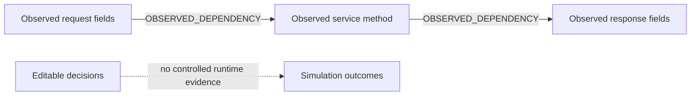

# Decision and result graph

The graph is deliberately conservative. It records fields present in observed RPC request/response schemas as `OBSERVED_DEPENDENCY` edges between a field and a service method. A field in a request does not prove that it controls a later result. The two pure client formulas may create `DIRECT_FORMULA` edges, but do not establish use by the server simulation.

This capture contains no verified writable decision contract or controlled before/after result pair. Therefore the graph does not claim causal links from price, advertising, product, workforce, capacity, or channel decisions to business outcomes. A large number of schema nodes reflect the breadth of response object fields, not a complete causal model.

Every edge carries provenance, confidence, reason, and evidence alias in `data/decision_graph.json`. The `trace_decision` helper follows only recorded directed paths and returns the graph's causal limitation with its result.
