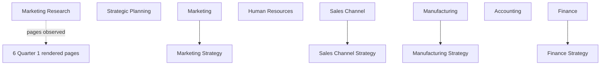

# Module and resource map

Six rendered pages were observed, all associated with Quarter 1 in the capture. Safe page titles include `Use Pattern`, `Market Potential-1`, `Market Potential`, and `Price Willing to Pay`; the remaining page title was not emitted because it did not pass the public-label allowlist. The module artifact uses aliases `page_001` through `page_006` and retains page-level quarter, title, tabs, decision-control presence, safe navigation labels, and referenced script names.

Navigation labels observed across the HTML include Marketing Research, Strategic Planning, Marketing / Marketing Strategy, Human Resources, Sales Channel / Sales Channel Strategy, Manufacturing / Manufacturing Strategy, Accounting, Finance / Finance Strategy, and Production. The rendered list nesting supports Marketing Research → Customer Needs / Use Pattern / Price Willing to Pay / Market Potential; Strategic Planning → Financial Resources / Summary of Strategy; and Accounting → Income Statement. Other nested links include Marketing Strategy, Sales Channel Strategy, Manufacturing Strategy, and Finance Strategy under their matching top-level sections.

The page-level `parent` stays unknown. Individual navigation elements include `parent_element` only when nesting is visible in the HTML; unlinked labels such as Production do not get an inferred parent.

The artifact is at `data/module_graph.json`. Its `decision_screen` flag means the exported HTML contained a form/input or an allowlisted control; it does not prove the screen writes to the server or can be safely edited.
